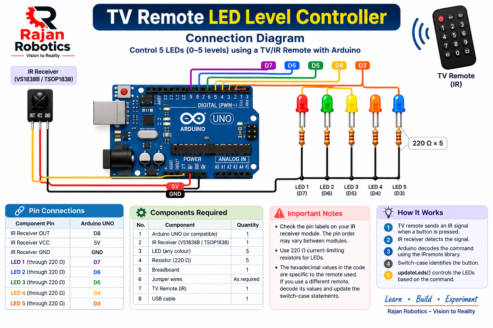
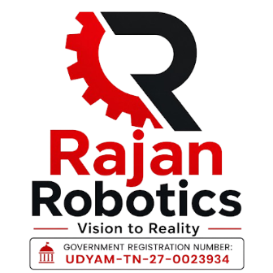

# 🚦 LED Pattern Control Using Two IR Sensors

### An Arduino-Based Robotics & Electronics Project

<p align="center">
  
</p>

<p align="center">
  <b>Rajan Robotics | Vision to Reality</b>
</p>

---

## 📌 Project Overview

This project demonstrates an interactive LED pattern control system using an **Arduino UNO, six LEDs, and two IR obstacle detection sensors**.

The system detects obstacles using left and right IR sensors and generates different LED lighting patterns depending on the sensor inputs.

It demonstrates digital input/output, sensor interfacing, conditional statements, loops, and function-based programming using Arduino.

## 🎯 Project Objectives

- Interface two IR obstacle detection sensors with Arduino UNO.
- Control six LEDs independently.
- Generate different LED patterns based on sensor inputs.
- Understand digital input and output operations.
- Learn Arduino programming through a practical electronics project.

---

## 🧰 Components Required

| S.No | Component | Quantity |
|---|---|---:|
| 1 | Arduino UNO | 1 |
| 2 | IR Obstacle Detection Sensor Module | 2 |
| 3 | LEDs (Red, Yellow, Green, Blue, etc.) | 6 |
| 4 | 220Ω Resistors | 6 |
| 5 | Breadboard | 1 |
| 6 | Jumper Wires | As required |
| 7 | USB Cable | 1 |

---

## 🔌 Circuit Connection Diagram

<p align="center">
  
</p>

### 1. LED Connections

Each LED is connected to an Arduino digital pin through a 220Ω current-limiting resistor.

| LED | Arduino Digital Pin |
|---|---|
| LED 1 | D13 |
| LED 2 | D12 |
| LED 3 | D11 |
| LED 4 | D10 |
| LED 5 | D9 |
| LED 6 | D8 |

**LED Connections:**
- Anode (long leg) → Arduino digital pin through 220Ω resistor.
- Cathode (short leg) → GND.

### 2. IR Sensor Connections

| IR Sensor | VCC | GND | OUT |
|---|---|---|---|
| Left IR Sensor | 5V | GND | D7 |
| Right IR Sensor | 5V | GND | D5 |

**Note:** Both IR sensors share the Arduino 5V and GND connections.

---

## ⚙️ Pin Configuration

| Arduino Pin | Connected Component | Function |
|---|---|---|
| D13 | LED 1 | LED Control |
| D12 | LED 2 | LED Control |
| D11 | LED 3 | LED Control |
| D10 | LED 4 | LED Control |
| D9 | LED 5 | LED Control |
| D8 | LED 6 | LED Control |
| D7 | Left IR Sensor | Obstacle Detection |
| D5 | Right IR Sensor | Obstacle Detection |
| 5V | Both IR Sensors | Power Supply |
| GND | LEDs and IR Sensors | Common Ground |

---

## 🧠 Working Principle

The two IR sensors detect obstacles independently.

The sensor modules used in this project follow **Active LOW logic**.

| Sensor Output | Condition |
|---|---|
| 0 (LOW) | Obstacle Detected |
| 1 (HIGH) | No Obstacle |

### Sensor Input Conditions

| Left IR (D7) | Right IR (D5) | Condition |
|---:|---:|---|
| 1 | 1 | No obstacle |
| 0 | 1 | Left obstacle detected |
| 1 | 0 | Right obstacle detected |
| 0 | 0 | Both obstacles detected |

---

## 💡 LED Pattern Operations

The program generates different LED patterns based on the IR sensor inputs.

| Condition | Function | LED Operation |
|---|---|---|
| No obstacle | `def()` | Running LEDs from left to right and right to left |
| Left obstacle | `lt_rt_all()` | Sequential LED illumination from left to right |
| Right obstacle | `rt_lt_all()` | Sequential LED illumination from right to left |
| Both obstacles | `both()` | Symmetrical LED illumination pattern |

### Pattern 1: Default Running LED Pattern

- LEDs illuminate one after another from left to right.
- The sequence reverses from right to left.

### Pattern 2: Left IR Sensor Detection

- All LEDs are switched OFF.
- LEDs illuminate sequentially from left to right.
- The pattern repeats while the left sensor detects an obstacle.

### Pattern 3: Right IR Sensor Detection

- All LEDs are switched OFF.
- LEDs illuminate sequentially from right to left.
- The pattern repeats while the right sensor detects an obstacle.

### Pattern 4: Both IR Sensors Detection

- LEDs illuminate in symmetrical pairs.
- The pattern creates an outward/inward visual effect.
- All LEDs are switched OFF between pattern sequences.

---

## 💻 Arduino Programming

**Development Environment:** Arduino IDE

**Board:** Arduino UNO

**Programming Language:** Embedded C / Arduino C++

### Libraries Required

No external libraries are required.

The project uses standard Arduino functions:

- `pinMode()`
- `digitalWrite()`
- `digitalRead()`
- `delay()`
- `Serial.begin()`
- `Serial.print()`
- `Serial.println()`

### Source Code

The complete Arduino program is available in this repository:

`RR_Arduino_LED_Pattern_Control_Using_Two_IR_Sensors.ino`

---

## 🚀 How to Upload the Program

1. Connect Arduino UNO to your computer using a USB cable.
2. Open Arduino IDE.
3. Open the `.ino` source file.
4. Select **Tools → Board → Arduino UNO**.
5. Select the correct COM port.
6. Click the Upload button.
7. Open Serial Monitor and select 9600 baud.
8. Adjust the IR sensor sensitivity using the onboard potentiometers if required.

---

## 📟 Serial Monitor Output

The program displays sensor readings and the currently executing function.

Example:

```text
Rajan Robotics
LED_IR-Pattern

left_status = 1
right_status = 1

Currently executing: lt_rt
Currently executing: rt_lt

left_status = 0
right_status = 1

Currently executing: all_off
Currently executing: lt_rt_all
```

---

## 🔍 Applications

- Robotics and obstacle detection demonstrations.
- LED running-light systems.
- Interactive electronics learning.
- Sensor-based lighting systems.
- Arduino programming practice.
- STEM and robotics workshops.

---

## 📚 Learning Outcomes

By completing this project, students can understand:

1. Arduino UNO architecture and GPIO pins.
2. IR obstacle sensor interfacing.
3. Digital input and output operations.
4. Active LOW and Active HIGH logic.
5. Array-based LED control.
6. `for` and `while` loops.
7. Conditional statements (`if`, `else`).
8. Function-based programming.
9. Serial Monitor debugging.

---

## 🏫 Project By

<p align="center">
  
</p>

<h3 align="center">RAJAN ROBOTICS</h3>

<p align="center">
  <b>Vision to Reality</b>
  <br>
  Government Recognised Enterprise
  <br>
  UDYAM-TN-27-0023934
</p>

<p align="center">
  <b>Learn • Build • Innovate</b>
</p>

---

⭐ If you find this project useful, consider giving this repository a Star!

**Rajan Robotics – Empowering the Next Generation Through Practical Learning.**
